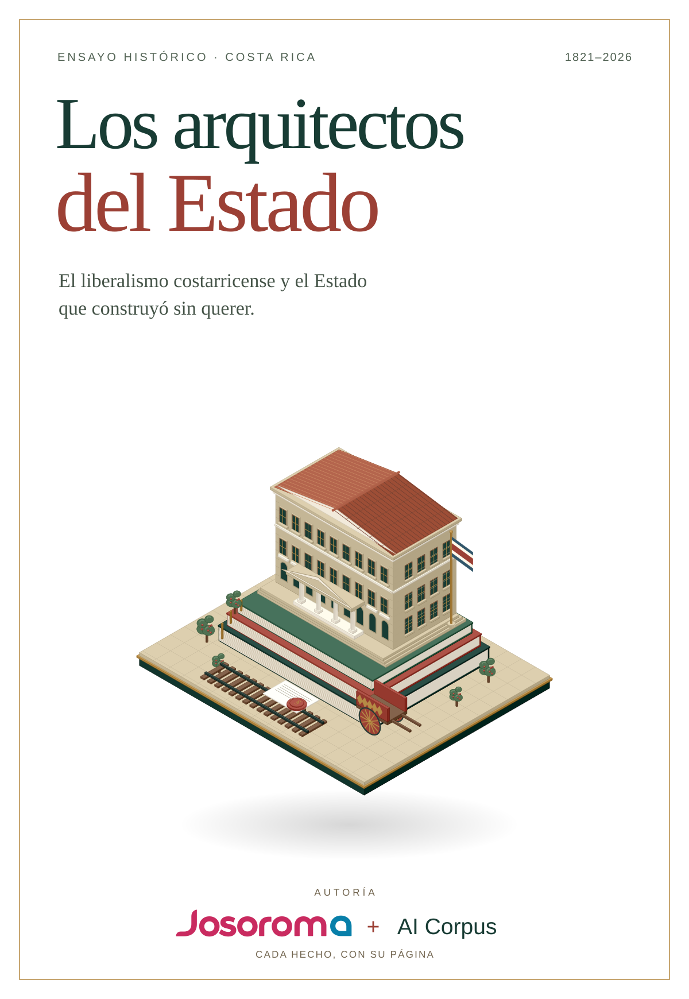

<div align="center">

# Los arquitectos del Estado

**El liberalismo costarricense y el Estado que construyó sin querer (1821-2026)**

Un libro de historia donde cada afirmación tiene su página.

<p> &nbsp;+ AI Corpus</p>

[](https://josoroma.github.io/Los-Arquitectos-del-Estado/)

### [Leer el libro en línea →](https://josoroma.github.io/Los-Arquitectos-del-Estado/)

*10 capítulos · 1 epílogo · ~30.000 palabras · 283 citas verificadas · 0 problemas*

</div>

---

## El problema

La historia del liberalismo en Costa Rica se cuenta siempre igual: primero fuimos liberales, después nos volvimos estatistas, y el Estado socialdemócrata llegó a corregir el desorden. Es una historia cómoda, y es falsa.

## Lo que este libro demuestra

**El liberalismo costarricense no fue víctima del Estado: fue su arquitecto.**

Cada reforma liberal del siglo XIX —los códigos, el ejército, el registro civil, la escuela pública, el crédito hipotecario— amplió la capacidad coercitiva que el liberalismo del siglo XX tendría que desmontar. El Estado que el Movimiento Libertario quiso reducir en 1998 lo había construido el liberalismo de 1888, con sus propias manos y su propia doctrina.

De ahí sale la herida del libro, y también su utilidad: **el libertarismo costarricense nace como crítica de una herencia propia, no de una ajena.** Quien no puede decir *nos equivocamos en 1888* tampoco puede decir *tenemos razón en 2026*.

## Por qué vale la pena

**Porque no pide confianza.** Los capítulos 1 a 9 remiten a una página concreta de una obra concreta. Puede leer de corrido sin ver una sola nota, o desconfiar en cualquier línea, tocar el número y encontrar el original. Un script compara las 283 citas literales letra por letra contra los libros y falla si algo no cuadra.

**Porque llega hasta hoy.** La bibliografía académica sobre el periodo termina en 2015; este libro sigue hasta 2026. El Partido Liberal Progresista, su mejor elección y su desaparición de la Asamblea. Otto Guevara asesorando *ad honorem* al gobierno de la derecha oficial. Ese tramo se apoya en resultados del TSE y en prensa, y lo declara en cada párrafo.

**Porque se lee como un relato, no como un expediente.** Sin diálogos inventados, sin héroes sin sombra, sin villanos sin razón.

**Porque termina en contra de sí mismo.** El epílogo es una autopsia: cinco cargos contra la tradición liberal costarricense —el populismo, la herencia no asumida, la legalidad confundida con la legitimidad, el monopolio reciclado y la cobardía intelectual— y una propuesta que no se apoya en las fuentes y así se declara.

## Para quién es, y para quién no

| Es para usted si… | No es para usted si… |
|---|---|
| quiere la historia del liberalismo costarricense sin mito de fundación | busca un panfleto a favor ni en contra del libertarismo |
| le interesa cómo se construye un Estado, no solo cómo se critica | espera una tesis sobre el presente sin archivo |
| desconfía de los libros de historia sin notas | le bastan las citas de segunda mano |
| quiere saber qué pasó en 1948 con nombres y votos | prefiere la versión de un solo bando |

## Edición ilustrada

Los diez capítulos y el epílogo tienen ilustraciones SVG originales, con una
paleta común de marfil, verde bosque, rojo óxido y latón sobre fondo transparente. Las escenas son
interpretaciones editoriales del relato, no reconstrucciones documentales.
El lector incluye temas claro y oscuro, búsqueda, navegación por secciones y
enlaces de ida y vuelta entre el texto y sus notas.

Para regenerar el arte y el lector, desde esta carpeta (Python 3 y Node.js 20+):

```sh
python3 -m venv .venv
.venv/bin/pip install markdown-it-py
.venv/bin/python docs/arte.py
.venv/bin/python docs/build.py
.venv/bin/python -m http.server 8000 --directory docs
```

Abrir <http://localhost:8000>. Las fuentes vectoriales editables, la paleta y
las referencias de diseño están en [docs/art/README.md](docs/art/README.md).
